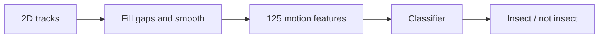

# TRAIT — Trajectory Recognition for Automated Insect Tagging

[](https://doi.org/10.26180/32737458)
[](LICENSE)
[](https://creativecommons.org/licenses/by/4.0/)
[](requirements.txt)
[](#citation)
[](https://github.com/malikaratnayake/TRAIT/releases/tag/wacv2027)

TRAIT is a Python toolkit for recognising insect movement from 2D tracks. It describes
how an object moves using **125 interpretable, behaviour-informed features**, then uses
a classifier to distinguish **insect** from **not insect**. The input is a sequence of
centroid positions and frame numbers, so classification works from tracks already
extracted by a tracking system. A CPU is enough to run the toolkit.

You can use the feature extractor on its own, train a classifier on your own labelled
tracks, or reproduce the experiments of the accompanying paper:

> Malika Nisal Ratnayake and Alan Dorin.
> **Detecting Insect Flight Trajectories for Pollinator Monitoring with Camera Traps.**
> *IEEE/CVF Winter Conference on Applications of Computer Vision (WACV)*, 2027.

[Dataset](https://doi.org/10.26180/32737458) ·
[Reproduction guide](docs/REPRODUCING_THE_PAPER.md)

TRAIT can be used to:

- filter tracks caused by background movement, such as wind-blown vegetation, shadows
  and camera shake;
- compute interpretable flight and movement features for ecological or behavioural analysis;
- train and compare trajectory classifiers on a labelled dataset with station-disjoint
  splits and cross-farm tests.

The repository brings together preprocessing, feature extraction, model training,
evaluation and plotting. The full dataset of 28,295 annotated tracks is available on
Figshare; two example tracks are included here to help you get started.



---

## Contents

- [What is in the toolkit](#what-is-in-the-toolkit)
- [Installation](#installation)
- [Quick start](#quick-start)
- [Using TRAIT on your own tracks](#using-trait-on-your-own-tracks)
- [Scope and limitations](#scope-and-limitations)
- [Dataset](#dataset)
- [Method overview](#method-overview)
- [Reproducing the paper](#reproducing-the-paper)
- [Citation](#citation)
- [Acknowledgements](#acknowledgements)
- [License](#license)

---

## What is in the toolkit

| Component | What it does | Script |
|---|---|---|
| Preprocessing | Fills gaps in tracks by linear interpolation and smooths them (Savitzky–Golay) | `src/utils/smoothing.py` |
| Feature extraction | Computes the 125 motion features for every track | `src/generate_features.py` |
| Data splits | Builds station-disjoint cross-validation folds, so no camera station is in both training and test data | `src/create_splits.py` |
| Classifiers | Logistic Regression, Random Forest and XGBoost on the features; 1D-CNN, miniROCKET and ConvTran on preprocessed trajectories | `src/models/`, `src/train_*.py` |
| Generalisation and ablation | Within- and cross-farm evaluation; domain, subgroup and feature-level ablations | `src/cross_farm.py`, `src/ablation.py` |
| Pipeline | Runs all of the above end to end, with checkpoints so it can be resumed | `run_pipeline.sh` |
| Comparison | Checks a run against the published results | `src/compare_results.py` |

---

## Installation

Python 3.10 or later is required; use **Python 3.10** to reproduce the paper.
The package versions in `requirements.txt` match those used for the reported experiments.

```bash
git clone https://github.com/malikaratnayake/TRAIT.git
cd TRAIT
python3.10 -m venv trait-env
source trait-env/bin/activate          # Windows: trait-env\Scripts\activate
python -m pip install -r requirements.txt
```

Check the main dependencies:

```bash
python -c "import numpy, scipy, pandas, sklearn, xgboost, joblib, matplotlib, torch, aeon, numba; print('OK')"
```

If a pinned package cannot be installed, check `python --version` first. Python 3.10
is the best starting point for resolving version compatibility problems. The pipeline
commands below use Bash; on Windows, run them in a Bash environment such as WSL.

---

## Quick start

Try feature extraction on the two included tracks first. This checks the input format
and feature calculations without downloading the full dataset or training any models:

```bash
python src/generate_features.py \
    --tracks-dir examples/tracks \
    --labels-csv examples/labels.csv \
    --fps 30 \
    --output-csv data/results/example/track_features.csv
```

You should see two processed tracks and 125 features per track. Some features can be
undefined for an individual track and appear as empty cells in the output.
The [example notes](examples/README.md) describe the source data.

When you are ready to train and evaluate models, [download the full dataset](#dataset)
into `data/` and run:

```bash
bash run_pipeline.sh --fps 30 --run-name my_run
```

Results are written to `data/results/my_run/`: the feature table, the model comparison, the
cross-farm and ablation results, and figures. This runs the full experimental pipeline,
including the sequence baselines, so it takes substantially longer than the example.
Each completed step is checkpointed; use the same command to resume an interrupted run.
Use `--dry-run` to preview the commands and `-h` to see the options. For the configuration
used in the paper, follow [Reproducing the paper](#reproducing-the-paper).

---

## Using TRAIT on your own tracks

Start with one CSV file per track, with columns `nframe,x,y`: an integer frame number
and centroid coordinates in pixels. Keep rows in time order, with one row for every
frame between the start and end of the track. Leave `x` and `y` empty for a missed
detection. If your tracker omits those frames entirely, insert the missing rows first:
gap filling operates on row positions and assumes evenly spaced frames.

Put the track CSVs directly in one folder and list them in a labels CSV with columns
`filepath,label`. Use `insect` or `not_insect` for the labels; `filepath` can be just
the filename, as in [examples/labels.csv](examples/labels.csv). Use the actual recording
frame rate in `--fps`; the dataset supplied with this project uses 30 fps.

**Extract the 125 features** for all tracks:

```bash
python src/generate_features.py \
    --tracks-dir path/to/tracks \
    --labels-csv path/to/labels.csv \
    --fps        30 \
    --output-csv features.csv
```

The output has one row per processed track, with its filename, binary label
(`1` for insect, `0` for not insect) and 125 features. The script fills gaps and smooths
the coordinates before extracting features. Feature names and groupings are defined in
`src/models/data_loader.py`; the supplementary material of the paper
gives their equations. You can use the feature table in your own analysis or with the
training code in `src/models/`. Missing feature values are filled from training-set
medians by the supplied model code.

The station-disjoint splits and the full pipeline (`src/create_splits.py`,
`run_pipeline.sh`) read the camera station from the track file name (see
[the naming convention](docs/REPRODUCING_THE_PAPER.md#file-naming)). To use them on
other data, follow the same pattern or adapt `src/utils/metadata.py`. The pipeline can
also use other folders through `--tracks-dir`, `--labels-csv`, `--features-csv` and
`--splits-csv`.

---

## Scope and limitations

TRAIT classifies movement in existing tracks. Its current labels distinguish insects
from other motion; they do not identify species or establish whether an insect is a
pollinator. The published evaluation covers two blueberry farms. Performance in other
habitats and camera setups needs to be checked on representative data.

Frame rate, camera distance, resolution and tracking quality can all affect the features.
For a new recording setup, evaluate the classifier on representative labelled tracks
and choose its decision threshold using validation data. Keep tracks from the same
camera station or recording group together when splitting data for evaluation.

---

## Dataset

The TRAIT dataset has 28,295 manually annotated 2D centroid tracks (3,644 insect, 24,651
not insect) from two commercial blueberry farms in Australia, recorded at 30 fps by camera
traps at 153 stations. It also includes the station-disjoint five-fold split used in the
paper. It is published on Figshare under CC BY 4.0:
[doi:10.26180/32737458](https://doi.org/10.26180/32737458).

Download `tracks.zip`, `track_classification.csv` and `splits_folds.csv`, put the two CSV
files in `data/` and extract `tracks.zip` there:

```
data/
├── tracks/                    # 28,295 CSV files, columns: nframe, x, y (pixels)
├── track_classification.csv   # columns: filepath, label (insect | not_insect)
└── splits_folds.csv           # the five-fold assignment used in the paper
```

The Figshare record also has a `README.txt` that describes the data in full, and
`SHA256SUMS.txt`. A copy of the files, `TRAIT_dataset.zip`, is attached to the
[`wacv2027` release](https://github.com/malikaratnayake/TRAIT/releases/tag/wacv2027);
the Figshare record is the one to cite. Track file names encode the camera station, for
example `FarmA_L1_S10_250729_093716_100005000023.csv` (farm A, location 1, station 10,
recorded on 2025-07-29 at 09:37:16, track 100005000023); see
[the details](docs/REPRODUCING_THE_PAPER.md#file-naming).

---

## Method overview

1. **Gap filling and smoothing.** Missed detections are filled by linear interpolation and
   the coordinates are smoothed with a Savitzky–Golay filter (11-frame window, order 2).
2. **Feature extraction.** 125 features in six domains (locomotion kinematics, path
   geometry, flight rhythm, navigation, sensorimotor control, behavioural states) and 32
   subgroups. No recording metadata (time of day, station, farm) is used.
3. **Station-disjoint evaluation.** Five folds grouped by camera station, so no station is
   in both training and test data; fold 4 is the held-out test set.
4. **Classification.** Logistic Regression, Random Forest and XGBoost on the features;
   1D-CNN, miniROCKET and ConvTran on the trajectories.

Full details, the feature domains and the repository layout are in
[docs/REPRODUCING_THE_PAPER.md](docs/REPRODUCING_THE_PAPER.md#method-overview).

---

## Reproducing the paper

For a reproduction, use the source archive from the
[`wacv2027` release](https://github.com/malikaratnayake/TRAIT/releases/tag/wacv2027),
or check out that tag in a clean clone before installing the dependencies. The default
branch may contain later changes.

The main experiments and ablations use deterministic, single-threaded CPU execution:

```bash
bash run_pipeline.sh --fps 30 --test-run --run-name paper
```

The reference outputs are attached to the
[`wacv2027` release](https://github.com/malikaratnayake/TRAIT/releases/tag/wacv2027) as
`WACV2027_paper_results.zip`. Use `src/compare_results.py` to compare the saved metrics
and predictions with your own run. The threshold-robustness study and ConvTran batch-size
study need [two additional commands](docs/REPRODUCING_THE_PAPER.md#supplementary-studies).
The [reproduction guide](docs/REPRODUCING_THE_PAPER.md) covers comparison options,
computing requirements and the output files behind each table and figure.

---

## Citation

If you use the code or dataset, please cite the paper (GitHub's "Cite this repository"
button uses `CITATION.cff`):

```bibtex
@inproceedings{ratnayake2027trait,
  title     = {Detecting Insect Flight Trajectories for Pollinator Monitoring with Camera Traps},
  author    = {Ratnayake, Malika Nisal and Dorin, Alan},
  booktitle = {Proceedings of the IEEE/CVF Winter Conference on Applications of Computer Vision (WACV)},
  year      = {2027}
}
```

and the dataset: Ratnayake, M. N. and Dorin, A. (2026). *TRAIT: Annotated Insect and
Non-Insect Trajectories from Camera Traps*. Monash University. Dataset.
https://doi.org/10.26180/32737458

Questions and bug reports are welcome as [GitHub issues](https://github.com/malikaratnayake/TRAIT/issues).

---

## Acknowledgements

This work was supported by the Australian Research Council Linkage Projects funding
scheme (project LP210200213), the Australian Blueberry Growers' Association and
Costa Group.

---

## License

- Code: GNU General Public License v3.0 (see `LICENSE`)
- Dataset: CC BY 4.0
